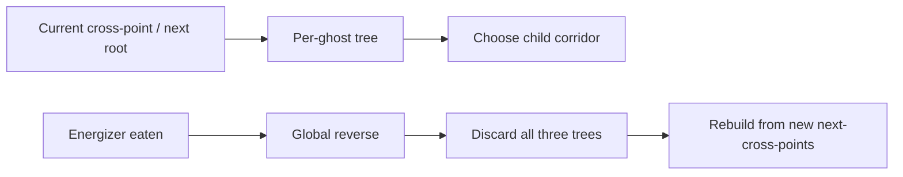

# Design Document

## 1. Overview

This project implements a Monte-Carlo Tree Search (MCTS) Pac-Man agent and a joint-action MCTS ghost-team agent for a custom Pac-Man clone, following the design proposed by Pepels & Winands (CIG 2012).  The implementation is in pure Python with no external ML dependencies.

---

## 2. Maze Representation and Graph Construction

Each maze is loaded from a JSON file that contains:
- `nodes` — walkable PATH / PATHBLANK cells
- `edges` — adjacency between nodes
- `walls` — impassable cells
- `ghost_walls` — the ghost-house door (walkable only by ghosts)
- `energizers` — power-pellet positions

Two graphs are built from this data:

**`pacman_graph`** (`dict[Pos, frozenset[Pos]]`)  
Contains all PATH/PATHBLANK nodes and their undirected edges, excluding ghost-house interior cells and the ghost-house door.  Pac-Man navigates exclusively on this graph.

**`ghost_graph`** (`dict[Pos, frozenset[Pos]]`)  
Extends `pacman_graph` with the ghost-house interior and the door cells.  A BFS flood-fill from each door cell (into cells not already in `pacman_graph` and not classified as walls) identifies the interior.  Ghosts navigate on this graph, allowing them to exit and re-enter the ghost house.

**Junction graph** (`dict[Pos, dict[Pos, int]]`)  
A compressed graph where every node is either a junction (≥ 3 neighbours) or a dead-end (1 neighbour), and every edge weight is the corridor length between two such nodes.  The junction graph is used as the MCTS tree backbone; corridors between junctions are replayed deterministically during tree traversal.

---

## 3. Tick-Based Simulator

`SimState` is an immutable data record (via `__slots__`) that holds the complete game state:
- `pacman_pos`, `ghost_positions` (list of 4)
- `ghost_frightened` (per-ghost remaining ticks)
- `active_pellets`, `active_energizers` (frozensets for O(1) membership tests)
- `step`, `outcome`, `energizer_penalty`

`step(state, maze, pac_action, ghost_actions)` advances the game by one tick:
1. Move Pac-Man and all 4 ghosts simultaneously.
2. Decrement frightened timers.
3. Consume pellets/energizers at Pac-Man's new position; set frightened timers on energizer pickup.
4. Check overlap and crossing collisions for each ghost.
5. Set `outcome` to `"eaten"`, `"cleared"`, or `"timeout"` as appropriate.

No mutation — every call returns a new `SimState` object.

---

## 4. MCTS Pac-Man Agent

### 4.1 Tree Structure

Each `MCTSNode` represents arrival at a junction via a particular corridor.  Children correspond to outgoing corridors (the reverse direction is forbidden past ply 1).  Each node stores max-backpropagated scores (`s_survival_max`, `s_pill_max`, `s_ghost_max`) and running means.

Variable depth: a child is only expanded if `node.depth_ticks + corridor_length ≤ T_path`.

### 4.2 Three-Tactic UCT Selection

At each decision point the agent selects one of three tactics:

| Tactic | Condition | UCT value |
|--------|-----------|-----------|
| Survival | `best_survival_max < T_survival` | `s_survival_max` |
| Ghost | ≥ 1 ghost frightened | `s_ghost_max × s_survival_max` |
| Pill | default | `s_pill_max × s_survival_max` |

The active tactic is chosen *after* all iterations complete (with "pill" used during exploration), so the tree is populated before the tactic switch.

`_best_child_dir` falls through: if the active tactic yields all-zero scores, it retries with "pill", then "ghost", then "survival".

### 4.3 Rollout Policy

Rollouts use lightweight distance-based policies:

**`_fast_pac_move`** — avoids non-frightened ghosts (hard block if ghost is at next cell, soft penalty within L1 ≤ 3), targets nearest pellet/energizer/frightened-ghost using a cached target (refreshed only when eaten, sampled from ≤ 32 candidates for speed).

**`_fast_ghost_move`** — L1-chase toward Pac-Man when not frightened (models worst-case ghost behaviour to make survival estimates conservative); flees when frightened.

Rewards:
- **R_survival** = 1 if alive at rollout end, 0 if eaten, 0 if energizer-double-penalty triggered
- **R_pill** = `pellets_eaten_in_rollout / pellets_at_root`
- **R_ghost** = weighted fraction of ghosts eaten (weight ∝ remaining frightened ticks at eat time)

### 4.4 Corridor Replay

During tree traversal, Pac-Man follows the BFS path between junctions step by step while ghosts move simultaneously (via `_fast_ghost_move`).  All junction-pair BFS paths are cached at `reset()` time for speed.

### 4.5 Endgame Tactic

The endgame tactic triggers when any of three conditions holds:
1. Fewer than `K_endgame = 40` pellets remain.
2. Nearest pellet is farther than `T_path` cells.
3. Five consecutive MCTS decisions return no valid direction.

In endgame mode the agent performs a **ghost-aware BFS**: cells adjacent to dangerous ghosts are marked as "avoid"; the shortest safe path to the nearest target (frightened ghost → energizer → pellet) is computed.  If no ghost-avoiding path exists, the search falls back to the unconstrained BFS.

### 4.6 Real-Time Safety Gate

On every tick, after computing the planned direction (from path-following or MCTS), a **safety gate** checks whether the next cell is at L1 distance ≤ 1 from any dangerous ghost outside the ghost house.  If unsafe:
- For path-following results: the path is invalidated and MCTS replans.
- For MCTS results and endgame results: the direction is replaced by the legal move that **maximises** the minimum L1 distance to any dangerous ghost.

This prevents Pac-Man from walking into a ghost due to model mismatch between the L1-chase rollout ghosts and the actual random ghosts.

### 4.7 Max-Backpropagation

All three reward signals are propagated upward using **max-backpropagation**: each node stores the maximum value seen across all simulations through that node (rather than the average).  Running means are also tracked for diagnostic purposes.

---

## 5. ICE gUCT Ghost-Team Agent

### 5.1 Why the old joint-action ghost MCTS was replaced

The previous ghost controller searched a Cartesian product of all four ghost
actions, which made the branching factor explode and left little room for deep
or stable lookahead.  It also had no competition pedigree.  ICE gUCT replaces
that joint-action tree with one tree per controlled ghost plus a fixed Blinky
rule, which keeps the search tractable and matches the 2011 ghost-side
competition-winning approach.

### 5.2 ICE gUCT overview

The ghost team uses four roles:

- Three ghosts run MCTS with their own per-ghost tree.
- One ghost plays the Blinky rule.
- Pac-Man during rollouts is predicted with KNN, then mixed with random legal
  moves using a decaying trust schedule.

The ghost-side search tree is built on the **inclusive ghost graph**, not the
Pac-Man graph.  That means the ghost-house door and interior are available to
ghost movement and to tree-root selection.

### 5.3 Tree structure and rebuild triggers

Each ghost tree is rooted at the next cross-point the ghost is about to reach.
In the grid simulator, that means: if the ghost is already at a cross-point,
the root is that position; otherwise the root is the next junction along the
current motion direction.

Children are the outgoing C-roads reachable from that root, excluding the road
the ghost just came from.  The node statistics are the usual `T_i` and `X_i`
pair for visit count and accumulated reward.

Tree rebuilds happen on two events:

1. The ghost reaches the current root cross-point and a new decision is needed.
2. A global reverse event occurs when Pac-Man eats an energizer.  In that case
	all three MCTS trees are discarded and rebuilt from the new next-cross-points.



### 5.4 The emergent-coordination trick

The key coordination trick is that, during a rollout for ghost G, the other two
MCTS ghosts do not move randomly.  They follow their current frozen trees from
the last completed search.  This gives each ghost partial knowledge of how its
teammates are planning and produces emergent pincer behaviour without a joint
action space.

### 5.5 The in-simulation Blinky random trick

During rollouts, Blinky is deliberately randomized at cross-points instead of
using its real chase rule.  That is non-obvious but intentional: it forces the
MCTS ghosts to plan as if Blinky will not provide free pressure, which makes
their selected plans more aggressive and less brittle.

### 5.6 Reward components and weights

The rollout reward is an additive combination of the paper’s original terms
plus a dispersal penalty:

$$
R = w_{capture} \cdot 1[pacman\_eaten]
  + w_{deny} \cdot (1 - pellets\_eaten / pellets\_at\_root)
  + w_{time} \cdot (1 - sim\_ticks / T_{sim})
  + w_{disperse} \cdot dispersal\_score
  - w_{eaten} \cdot (frightened\_ghosts\_eaten / 4)
$$

The current defaults are:

- `w_capture = 1.0`
- `w_deny = 0.3`
- `w_time = 0.1`
- `w_disperse = 0.1`
- `w_eaten = 0.5`

That weighting keeps capture as the primary signal, but still encourages pellet
denial, short rollouts, and team spread.

### 5.7 KNN predictor: input space, move space, prediction algorithm

The predictor uses the ten features described in the task brief:

1. distance to nearest ghost
2. distance to 2nd-nearest ghost
3. distance to nearest energizer
4. distance to nearest pellet
5. distance to nearest cross-point
6. nearest ghost edible flag
7. 2nd-nearest ghost edible flag
8. nearest-energizer’s nearest-ghost edible flag
9. distance from Pac-Man to that ghost
10. distance from the energizer to that ghost

All distances are normalized by graph diameter.  The move space stores the
feature delta between the pre-move and post-move state.  Prediction works as a
weighted average over the `k = 3` nearest neighbors in input space, followed by
a nearest-candidate-direction search over the legal Pac-Man directions.

The collection script bootstraps the dataset from heuristic-Pac-Man rollouts so
the ghost agent is usable before any better Pac-Man model exists.

### 5.8 Adaptations vs. the paper

| Category | Details |
|---|---|
| Kept | Per-ghost trees, KNN predictor, UCB1 selection, Blinky rule, in-sim randomized Blinky |
| Changed | Global reverse is detected from the simulator’s frightened-timer transition; terminal conditions follow the grid simulator’s discrete tick model |
| New | Explicit dispersal score, decayed predictor trust, bootstrap data collection script |

### 5.9 Cold-start strategy

The KNN predictor reloads `data/knn_train/dataset.npz` at construction time.
If the dataset is empty or missing, it warns and falls back to random legal
move selection.  To bootstrap the dataset, run the collection script with the
built-in heuristic Pac-Man:

```bash
python scripts/collect_trajectories.py \
	 --maze-dir generated_maze \
	 --pacman heuristic \
	 --ghosts random \
	 --n-games 100 \
	 --out data/knn_train/
```

### 5.10 Limitations

The current implementation still has a few deliberate simplifications:

1. It uses a single accumulated reward per node rather than a more elaborate
	max/mean split for different tactics.
2. Endgame play is not special-cased for the ghosts beyond the regular rollout
	reward.
3. The KNN model is only as good as the trajectories it was trained on.
4. The grid simulator is discrete, so the original arcade’s sub-cell timing is
	approximated rather than reproduced exactly.

---

## 6. Baseline Agents

**RandomPacmanAgent / RandomGhostsAgent** — uniform random legal moves; ghosts apply the no-reverse rule.

**HeuristicPacman** — BFS to nearest pellet with ghost-avoidance weight; uses Last-Good-Reply (LGR) to cache the last winning move.

**HeuristicGhosts** — BFS chase when Pac-Man is visible; random walk otherwise; applies ε-greedy exploration and the Case-3 no-duplicate-edge rule.

---

## 7. Session Recording and Replay

Every game can be recorded as a Python `dict` pickle (`SessionRecord`).  The schema stores:
- `graph` in COO format (for use with graph-neural network frameworks)
- per-frame observations (positions, frightened timers, active pellets/energizers)

The **replay viewer** (`src/viewer/replay_viewer.py`) uses Pygame to display frames at interactive speed:
- Pac-Man shown in yellow; ghosts colour-coded by index and flash blue when frightened.
- **Heatmap overlay** (`H` key) visualises per-cell visit frequency accumulated across all frames.
- Keyboard controls: Space (play/pause), arrow keys (step), Q (quit).

---

## 8. Benchmark Harness

`benchmark()` in `src/benchmark/harness.py` runs every (pacman, ghosts, maze) combination in parallel (using `concurrent.futures.ProcessPoolExecutor`) and aggregates results into a `BenchmarkReport`.  The `summary()` method returns a JSON-serialisable dict with win rates, mean steps to win/loss, and 95 % Wilson score confidence intervals.

---

## 9. Performance

With default parameters (`n_iterations=60`, `T_time=40`):
- ~13 ms per game step on a modern CPU
- ~10–20 s per game (600–1800 steps)
- 85 % win rate (17/20 games) vs random ghosts on the included maze

The main optimisations applied:
- Pre-computed `_CARD4` tuples avoid Python enum `__get__` overhead in tight loops.
- BFS corridor paths between junctions are cached at `reset()` time (108 paths for this maze).
- Target pellet search is limited to ≤ 32 random candidates per step (sufficient for rollout quality).

---

## 10. Known Limitations

1. **Ghost model mismatch** — rollout ghosts use L1-chase (worst-case model); real ghosts are random.  The safety gate partially compensates, but Pac-Man can still be cornered when all escape routes are blocked simultaneously by multiple ghosts.

2. **Single-maze training** — the current benchmark uses one maze.  Performance on structurally different mazes (very long corridors, multiple ghost houses) has not been evaluated.

3. **No energizer strategy** — the MCTS rewards energizer use (`R_ghost`) but does not explicitly plan multi-ghost combos; the Ghost tactic activates reactively rather than proactively.

---

## 11. References

- Pepels, T. & Winands, M. H. M. (2012). *Enhancements for Monte-Carlo Tree Search in Ms Pac-Man*. IEEE CIG 2012.
- Browne, C. et al. (2012). *A Survey of Monte Carlo Tree Search Methods*. IEEE TCIAIG.
